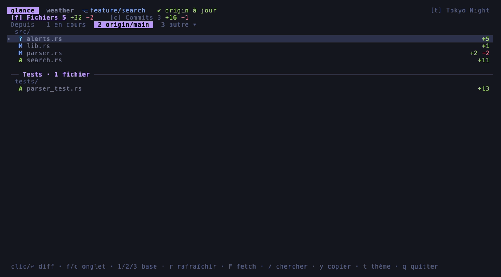
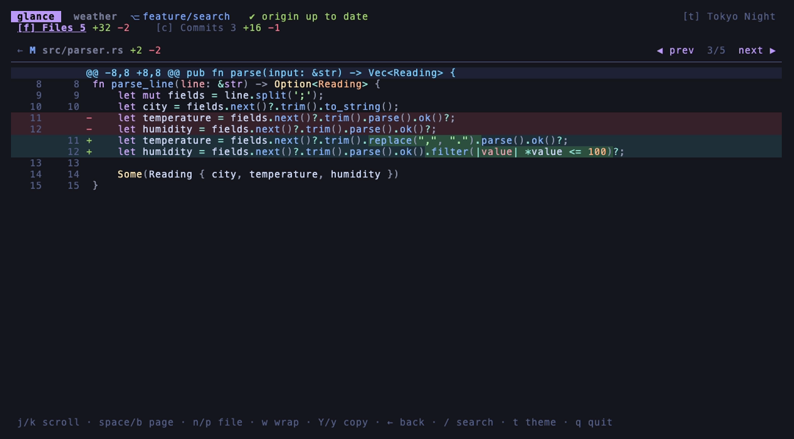
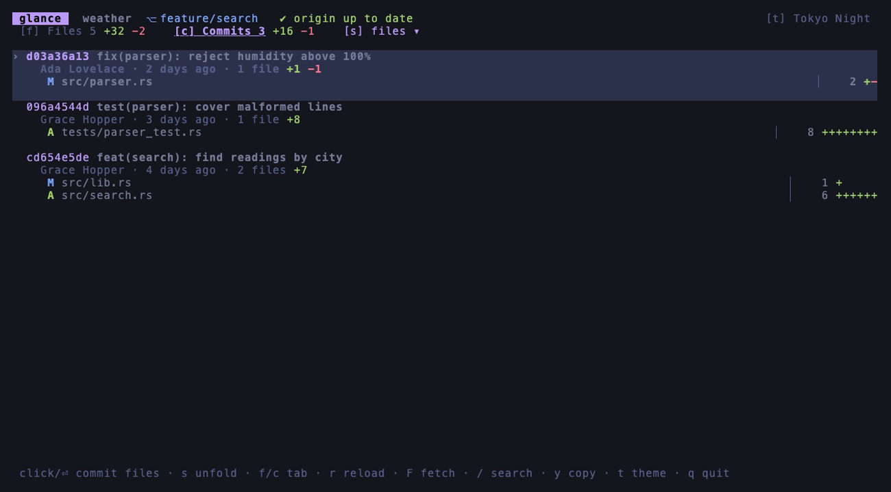
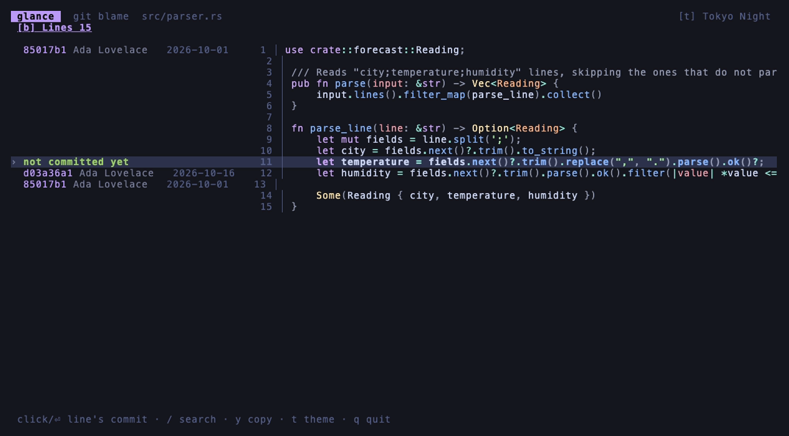

# glance

**A git pager and branch browser for the terminal.**
Diffs, logs, stashes and blames become lists you can scroll, search and click through instead of a wall of text in `less`.

[](https://github.com/sachadvr/glance/actions/workflows/ci.yml)
[](#license)



## A note from the author

I am still learning Rust: I know the basics, not the trickier corners. I wrote glance in Rust to see how far the performance could go: the same interface used to be a React TUI running only on my machine. An experienced Rustacean will surely find things to improve: idioms, performance, error handling, structure.

**Contributions are very welcome**, from typo fixes to deep refactors, and so is feedback on what could be done better. See [Contributing](#contributing).

## Screenshots

| Diff with syntax colours and changed words emphasised | Commits unfolded into their files |
|---|---|
|  |  |

**As git's pager**, a `git blame` you can follow to the commit that wrote each line:



The screenshots are taken in a real terminal by [`scripts/screenshots.sh`](scripts/screenshots.sh), using [VHS](https://github.com/charmbracelet/vhs) on a generated demo repository.

## Features

- **Two ways in**
  - **As git's pager:** `git diff`, `git log`, `git show`, `git stash list`, `git reflog`, `git branch`, `git status` and `git blame` open in glance instead of `less`.
  - **As a branch browser:** run `glance` in a repository to see your uncommitted work and the commits of your branch.
- **Readable diffs**
  - Syntax highlighting, using bat's grammars: TypeScript, Vue, PHP, Rust, Dockerfile…
  - Line numbers on both sides.
  - Word-level highlighting of what actually changed in a modified line.
  - Long lines wrap if you want them to.
  - A changed image (PNG, JPEG, GIF, WebP) shows its current version instead of "Binary files differ": with the terminal's graphics (kitty, iTerm2, sixel), in coloured half blocks elsewhere.
- **Files grouped the way you read them:** by directory, with the tests in their own section after the code.
- **"Changed since…"**
  - Compare against your uncommitted work, your main branch (`origin/main`, found automatically) or any commit of the branch.
  - The remote is fetched in the background when the browser starts.
- **Blame you can follow:** jump from a line to the commit that last wrote it.
- **Branches and status you can open:** a branch opens on its tip commit's files, the current one marked `*`; a status file opens on its uncommitted diff.
- **Search** in any list or diff with `/`, step through matches with `n` / `N`.
- **Copy** a path, a hash or a whole diff with `y` / `Y`. It goes through the terminal (OSC 52), so it also works over SSH.
- **Mouse support:** click rows, tabs and buttons, and scroll with the wheel.
- **6 themes:** Tokyo Night, Catppuccin Mocha, Dracula, Nord, Gruvbox Dark and GitHub Light. Your choice is remembered.
- **English and French:** the language follows your locale. Adding a language is a single file.

Anything glance does not recognise (`--stat`, `git shortlog`, a `git status` in a translated git…) is handed to `less`, as git would have done.

## Install

glance runs on **macOS and Linux**. You need **git**, and **less** for the output glance does not handle itself.

From source, with Rust 1.90 or later:

```sh
cargo install --git https://github.com/sachadvr/glance
```

Or from a clone:

```sh
git clone https://github.com/sachadvr/glance
cd glance
cargo install --path .
```

## Use it as git's pager

```sh
git config --global core.pager glance
```

To use it only for the commands it is made for, and keep `less` for the rest:

```sh
git config --global pager.diff glance
git config --global pager.log glance
git config --global pager.show glance
git config --global pager.blame glance
git config --global pager.branch glance
git config --global pager.status glance
```

`git status` does not use a pager unless `pager.status` is set; `git branch` uses one when listing branches.

Then use git as usual: `git diff`, `git log -p`, `git show HEAD~2`, `git log --oneline --graph`, `git stash list`, `git branch -vv`, `git status`, `git blame src/main.rs`.

To browse the current branch, run `glance` in the repository, with nothing piped to it.

## Keys

The footer always shows the keys that work on the current screen.

| Key | Action |
|---|---|
| `↑` `↓` / `j` `k` | Move, or scroll in a diff |
| `PgUp` `PgDn` | Move by a page |
| `space` `b`, `ctrl-d` `ctrl-u` | Scroll a diff by a page / half a page |
| `g` `G` / `Home` `End` | First / last |
| `⏎` / `→` / `l` | Open |
| `esc` / `←` / `h` | Back. On the first screen, `esc` quits |
| `n` `p` / `]` `[` | Next / previous file, inside a diff |
| `w` | Wrap long lines in a diff |
| `f` `c` / `tab` | Switch tab |
| `s` | Unfold each commit's files in the commit list |
| `1` `2` `3` | Count changes from: uncommitted work / main branch / a chosen commit |
| `r` / `F` | Reload / fetch `origin` |
| `/` then `n` `N` | Search, next / previous match (`esc` clears it) |
| `y` / `Y` | Copy the path or hash / the whole diff |
| `t` | Next theme |
| `q` / `ctrl-c` | Quit |

## Configuration

There is no configuration file to write.

- **Theme:** the one you pick with `t` is saved to `$XDG_CONFIG_HOME/glance/theme`, or `~/.config/glance/theme` if `XDG_CONFIG_HOME` is not set.
- **Language:** English or French, taken from your locale (`LC_ALL`, `LC_MESSAGES`, then `LANG`). English is used for any other locale. To choose one regardless of your locale:

  ```sh
  export GLANCE_LANG=fr   # or en
  ```

## How it works

glance has two entry points:
- When git runs it as a pager, it reads what git piped and works out the format: log, oneline log, reflog, stash list, branch list, status, blame or patch. It then shows it as lists.
- When run in a repository, it asks git directly.

The code is organised so that a new screen, input format, theme or key is added rather than edited in. [`ARCHITECTURE.md`](ARCHITECTURE.md) explains the layers and the extension points.

## Contributing

Issues and pull requests are welcome, and code review is especially appreciated: see [A note from the author](#a-note-from-the-author). [`CONTRIBUTING.md`](CONTRIBUTING.md) explains how to build, test and add a feature. Please follow the [code of conduct](CODE_OF_CONDUCT.md).

## License

Licensed under either of

- Apache License, Version 2.0 ([LICENSE-APACHE](LICENSE-APACHE))
- MIT license ([LICENSE-MIT](LICENSE-MIT))

at your option.

Unless you explicitly state otherwise, any contribution intentionally submitted for inclusion in the work by you, as defined in the Apache-2.0 license, shall be dual licensed as above, without any additional terms or conditions.
